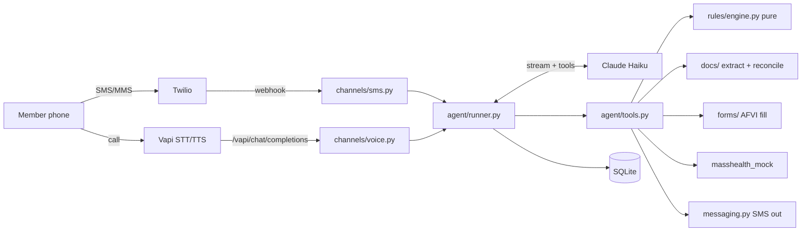

# Design Document

## Overview

MassHelp is a FastAPI app with two thin channel adapters (Twilio SMS, Vapi voice) in front of one channel-agnostic agent runner. The runner streams Claude (`claude-haiku-5-5`) with server-side tools. Outcomes come only from a pure rules engine. MassHealth is a mock. The only form is the AFVI "Attestation Form to Verify Income" (`assets/AFVI_2025-10.pdf`).

## Key decisions

| Decision | Choice | Why |
| --- | --- | --- |
| Outcomes | `rules/engine.py`, pure function over `MemberFacts` | G4, R19. Testable with Hypothesis. |
| Policy numbers | `rules/masshealth_rules.yaml`, validated at load (income = hours x wage) | Policy is not final. Prompt policy text is generated from the same file. |
| Combination path | `max(work_hours, income/7.25) + volunteer + training >= 80` | Income and hours from the same job aren't double counted. [DEFAULT], flagged in notes. |
| Gig income | Net of business costs; gross plus a note if costs unknown | SPEC 3.2 [DEFAULT]. |
| Form | AFVI only (team decision). Values drawn at each AcroForm field's rectangle with reportlab, then widgets removed (flattened). | Renders the same in every viewer, including phone browsers. Covers income, seasonal, work hours, and combination paths. Exemption, school, and volunteer-only paths return `form_not_supported` and get the MassHealth number. |
| Transcript | Full Claude content blocks per message, redacted before storage; history rebuilt from SQLite each round, consecutive same-role messages merged | Cross-channel continuity (G3), exact replay. |
| Prompt caching | Static system prompt with `cache_control`; per-turn context block after it | SPEC 5.2. |
| SMS disclosure (R32) | Fixed i18n line prepended by the runner on the first SMS reply of a conversation (12h gap) | Deterministic, not left to the LLM. |
| Voice disclosure (R32) | Vapi `firstMessage`; runner records it in the transcript on the first request of each call | |
| Consent (R28) | `record_consent` stores the member's actual last message (not the model's paraphrase) and requires a clear yes in code | Defense against the model inventing consent. |
| Stale consent | Consent stores a hash of the form's facts; submit rebuilds and compares. Proof arriving later doesn't invalidate it. | Maria's screenshot can arrive after she says yes on the call. |
| Proof gate | Submit refuses until proof covers the path or `attestation_accepted=true` | SPEC 9.1 step 8 [DEFAULT]. |
| Mismatch (R22) | Docs scaled to a month (period length or pay frequency), stubs averaged, compared to stated gross (two-sided) or stated net (doc may be higher) | |
| Locks | Per phone number (adapters) and per case (runner) | Serialize quick double texts and SMS arriving during a call. |
| No API key | `MissingKeyLLM` makes every turn send the R36 fallback | App boots for demos and tests without secrets. |

## Data model

SPEC 5.9 tables plus `MockRequest` (what MassHealth asked for) and `FormPdf` (draft or final PDF with an expiring random token for `/files/{token}`).

## Testing

- `tests/test_rules_engine.py`, `tests/test_rules_properties.py` (Hypothesis): every path, exemption, edge value; the five SPEC 10 properties.
- `tests/test_redact.py` (Hypothesis): SSN-shaped and card-shaped strings removed.
- `tests/conversations/`: demo 9.1 and 9.2 end to end with `ScriptedLLM` (real tools, engine, PDF, SMS fakes), plus lockout, unknown number, SSN, refusal, and consent checks.
- `tests/test_channels.py`: Twilio signature, empty TwiML, STOP, media download auth; Vapi SSE format, auth, filler before tool.
- `tests/test_forms.py`: AFVI mapping matches the template, output is flat and watermarked on every page, `DEMO_FIXED_PDF`.
